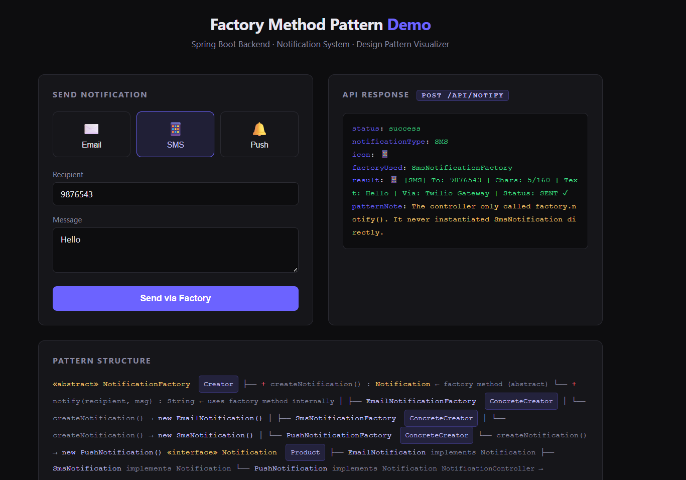

# Factory Method Pattern — Notification Demo

This Java 17/Spring Boot project demonstrates **Factory Method**.
`NotificationFactory` declares `createNotification()`; separate concrete
creators instantiate EMAIL, SMS and PUSH products. The controller uses an
abstract factory and works with the `Notification` interface.

These channels **simulate** delivery by formatting text; they do not send
email, SMS, or push messages. The API now reports `simulated` rather than
claiming successful delivery.

## Run

From the repository root, with Java 17 and Maven:

```bash
mvn spring-boot:run
mvn test
```

Open `frontend.html` in a browser. Request:

```bash
curl -X POST http://localhost:8080/api/notify \
 -H 'Content-Type: application/json' \
 -d '{"type":"EMAIL","recipient":"hello@example.com","message":"Hi!"}'
```

`GET /api/notify/types` lists the available channels. Unsupported types
return HTTP 400. One notification object is created for each request.

### Factory Method versus Abstract Factory

**Factory Method** delegates creation of a product to a subclass, whereas
**Abstract Factory** supplies an interface to create a *family* of related
products (for example, engines and wheels for one vehicle type).

To extend this example, add a new `Notification` product, its concrete
factory, and register it; the controller does not need a new branch.


